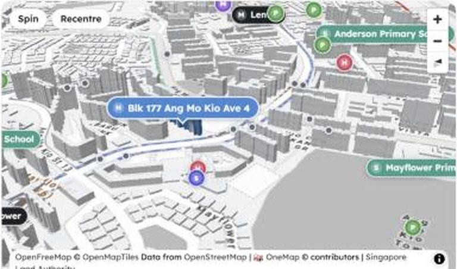
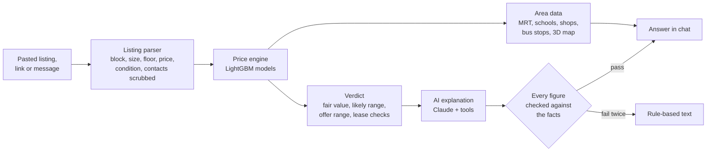

# Kampong

**Is that flat really worth the asking price?** Kampong is a chat-first price checker for Singapore homes.
Paste a property listing (or a link to one) and it compares the flat with what similar flats actually sold for,
then gives a verdict, an offer range and what's around the home on an interactive 3D map.

A personal project, built end to end: data pipeline, machine-learning models, API, front end, AI chat and deployment.



## Highlights

- **Accurate prices.** LightGBM models trained on every HDB resale since 2017 (about 245,000 sales) and on
  URA condo transactions. Half of HDB estimates land within **2.7%** of the price the flat later sold for, tested
  on months the model had never seen (a naive baseline misses by 5.1%). Condos: 2.9%. Price ranges are calibrated,
  and each month's estimates are checked against real sales.
- **Honest experiments.** New features are only adopted if they beat the current model on more than one held-out
  period. For example, block height, nearby new supply and planned MRT lines were tested and rejected
  (`src/experiments_hdb_extra.py`).
- **AI that can't make numbers up.** The chat uses Claude with tools that call the price engine. Every dollar figure,
  percentage and date in an answer is checked against the facts; a failed check is retried, then replaced with
  rule-based text.
- **Reads real listings.** Pasted listings are parsed into facts (block, size, floor, price, renovation, view),
  with contact details scrubbed. A pasted link is read once, with an honest user agent, respecting robots.txt
  ([how](web/bosan.html)).
- **3D area map.** MapLibre GL over OneMap tiles, with OpenStreetMap buildings, the home's own block highlighted,
  and MRT, planned stations, schools, bus stops and daily needs pinned.
- **Accessible.** Checked with GovTech's Oobee scanner (0 must-fix issues): keyboard-usable maps, screen-reader
  labels, 4.5:1 contrast, reduced-motion support.
- **Runs cheaply.** FastAPI + SQLite on one machine, exposed through a Cloudflare Tunnel, with nightly backups to
  Cloudflare R2. Optional Stripe billing and WorkOS sign-in.

**Stack:** Python, pandas, LightGBM, FastAPI, SQLite, vanilla JavaScript, MapLibre GL, Leaflet, Claude API,
Cloudflare (Tunnel, R2, Turnstile), Stripe. **Data:** data.gov.sg (HDB resale, HDB property information), URA, OneMap,
LTA/OpenStreetMap, all public.

The original modelling plan and its go/no-go decisions are in [PLAN.md](PLAN.md).

## How it works



1. **Understand the message.** `src/listing_parser.py` turns free text (a pasted PropertyGuru-style listing, or
   just "blk 177 amk ave 4, 4 room, asking 598k") into a flat: town, street, block, flat type, size, floor and
   price. It fills gaps with sensible defaults and says what it assumed. Mistyped postal codes are corrected
   from the block number. Agent names, phone numbers and emails are removed before anything is stored.
2. **Price it.** The engine (`api.py`, `src/train_production.py`, `src/condo.py`) predicts a fair value and a
   likely range, and compares the asking price with recent sales in the same block and nearby.
3. **Give a verdict.** Fair value, the range most sales land in, an offer range, the cash a buyer would need
   above the bank's valuation, lease checks against the buyer's age, and recent sales on the same floors.
4. **Explain it.** `src/llm.py` hands Claude the flat's facts and two tools that query the engine. The reply is
   scanned for numbers; any dollar figure, percentage, year or size not found in the facts fails the check.
5. **Show the area.** `src/nearby.py` finds the nearest MRT (and planned stations with opening years), primary
   schools, hawker centres, supermarkets, parks, clinics and bus stops. The front end draws them on a 3D map.

## The price model

| | HDB resale | Private condos |
|---|---|---|
| Training data | every resale since 2017 (~245,000) | URA caveats (transactions) |
| Model | average of 3 LightGBM models (different seeds) | LightGBM with comparable-sales features |
| Key inputs | flat type, town, model, size, storey, remaining lease, location, distance to MRT / hawker / schools / CBD, sale month | project, size, floor, tenure, recent sales of similar size in the project, the developer's own prices, the unit's size and floor relative to its project |
| Typical miss (median, unseen months) | **2.7%** (naive baseline 5.1%) | **2.9%** |

- **Recency weighting:** recent sales count more (36-month half-life), so the model follows the market.
- **Common-sense constraint:** price is not allowed to rise as the remaining lease falls (a monotone constraint).
- **Honest testing:** every figure above comes from training only on sales before a cut-off and testing on the
  months after it. New features must win on more than one such period before they are adopted.
- **Likely ranges** come from a separate range model and are checked so that they hold about as often as they claim.
- **Track record:** each month, estimates made beforehand are compared with what flats actually sold for.

**What didn't work** (kept in the repo on purpose):
- Long-range forecasts of a flat's future value: the lease-decay effect failed back-testing, so the app shows
  scenarios, not predictions (`src/backtest_forecast.py`).
- Block height, new supply nearby and planned MRT lines made the HDB model no better (`src/experiments_hdb_extra.py`).
- Macro indicators (GDP growth, inflation, interest rates) didn't make long-run growth assumptions any better
  in leave-one-year-out tests (`src/backtest_macro.py`).

## Repository layout

| Path | What's there |
|---|---|
| `api.py` | FastAPI app: chat understanding, assessments, maps, accounts, billing |
| `web/` | the single-page front end (vanilla JS), front page, icons |
| `src/download_*.py`, `geocode_*.py` | data downloads from data.gov.sg, URA, OneMap and OpenStreetMap |
| `src/build_features.py`, `neighbor_features.py`, `condo_features.py` | feature engineering |
| `src/train_*.py`, `range_model.py` | model training |
| `src/experiments_*.py`, `backtest*.py` | experiments and back-tests, including the rejected ideas |
| `src/listing_parser.py`, `linkreader.py`, `listings.py` | reading pasted listings and links |
| `src/llm.py` | the AI explanations and their fact checks |
| `src/nearby.py` | what is around a home, and commute times via OneMap |
| `tests/check_messages.py` | 77 chat-understanding cases |
| `scripts/` | start/stop scripts, backups to Cloudflare R2, logo generator |
| `design/` | mockups made along the way |

## Design decisions

- **Chat first.** People paste a listing or type the block, rather than filling in a form.
- **Explain, don't just score.** Every verdict says why, and what Kampong assumed.
- **Trust over polish.** The AI can't invent figures; when it fails the check, plain rule-based text is used instead.
- **Privacy.** No agent or seller contact details are kept. Links are read once, only when a person pastes them,
  with a user agent that names Kampong, and sites can opt out in robots.txt.
- **Cheap to run.** One machine, SQLite, public data and free map tiles. The AI is the only running cost, with
  daily budgets and a rule-based fallback.
- **Colour means something.** Blue for HDB, purple for condos, orange only for "check this", green and red only
  for money going up or down.

## Limitations

- Estimates assume typical condition. Renovation, views and facing aren't in sale records, so they are flagged
  from the listing text, not priced.
- Landed homes aren't covered yet.
- Distances are straight lines. For Primary 1 registration, OneMap's School Query is the official measure.
- Building heights on the 3D map come from OpenStreetMap and can be rough.
- This is a personal project, not financial advice.

## Setup (any machine)
```
python -m venv .venv
.venv\Scripts\python -m pip install -r requirements.txt
.venv\Scripts\python src\download_data.py
```
`data/` and `models/` are not in Git. The download script rebuilds `data/raw/`,
and skips files that already exist (use `--force` to refresh).

## Data
HDB resale flat prices from data.gov.sg, split into five files (1990 to now).
All five share the same columns, except `remaining_lease`, which only exists
from 2015 onward.

## Use it
```
.venv\Scripts\python src\update.py      # refresh data, rebuild features, retrain (about 3 minutes)
.venv\Scripts\python -m streamlit run app.py    # local app: price today plus scenarios for later
```
`update.py` needs `ONEMAP_TOKEN` in `.env` only to geocode brand-new blocks; without it those
sales are left out until the token is renewed. If data.gov.sg's download link stalls, the
download step falls back to its paged query API automatically.

## How well does it work?
- Price today: median error about 2.8% on months the model had not seen (baseline: 5.1%).
- Forecasts: scenarios only. The lease-decay effect failed back-testing (see PLAN.md).

## Check flats you know
Add rows to `cases/known_cases.csv` (or point `listing_file` at a text file of a pasted listing), then:
```
.venv\Scripts\python src\score_cases.py
```

## Kampong web app (API + front end)

Kampong (called Oikos until November 2026) is the product; the company behind it is Oiko. Internal names such as the `oikos_session` cookie, `data/oikos.db` and `OIKOS_*` settings keep the old name on purpose.
```
.venv\Scripts\python -m uvicorn api:app --port 8700
```
Then open http://localhost:8700. `api.py` wraps the models (`/api/options`, `/api/parse`, `/api/assess`)
and serves the page in `web/`. The Streamlit app (`app.py`) still works and is now the fallback.

## Ask Kampong (the AI explanations)
Add `ANTHROPIC_API_KEY=...` to `.env`. The model (default `claude-haiku-5-5`, set `OIKOS_LLM_MODEL` to change it)
does not learn from our data: for each question it is handed that flat's facts and two tools that call the
engine, then explains them. Every dollar figure, percentage, year count and size in its answer is checked against
those facts; a failed check is retried once, then replaced by rule-based text. Without a key the tab shows the
rule-based text. Code: `src/llm.py`; endpoint: `POST /api/ask`.
